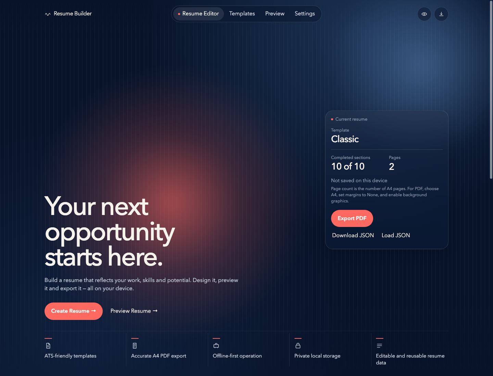
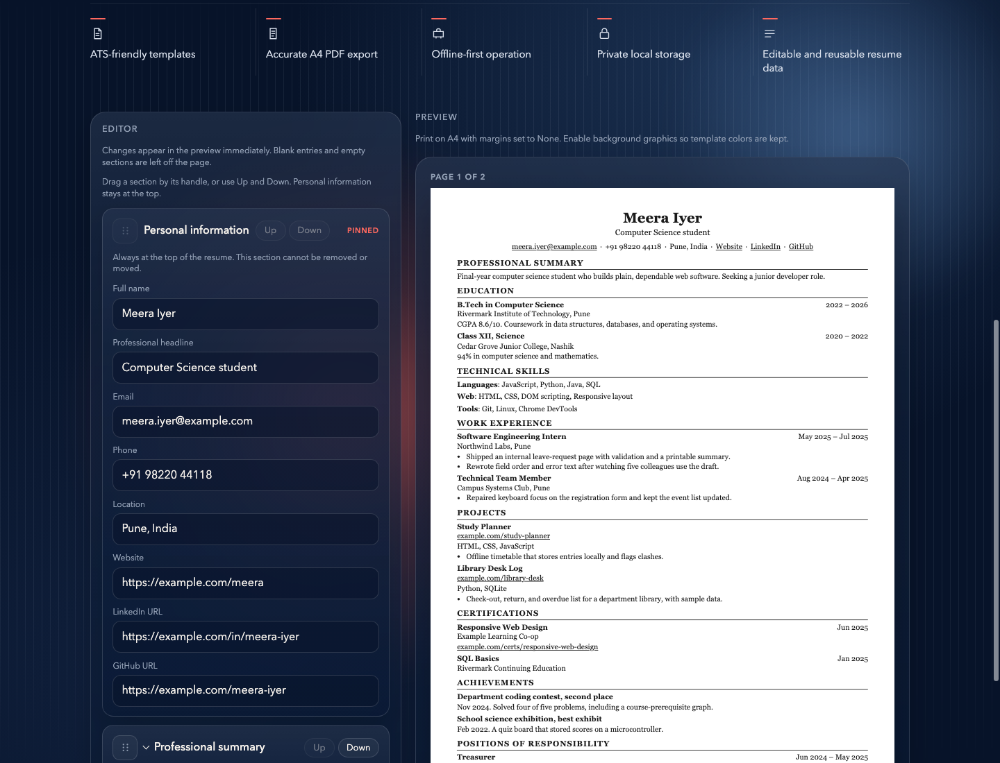
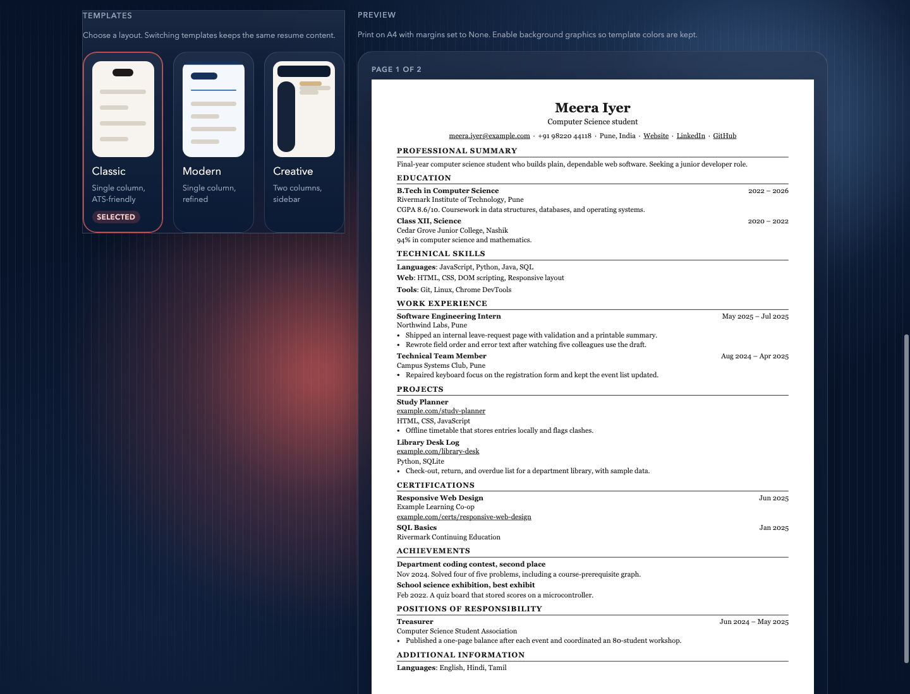
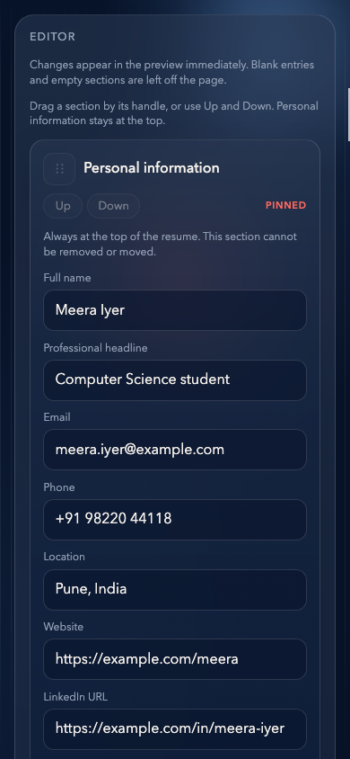
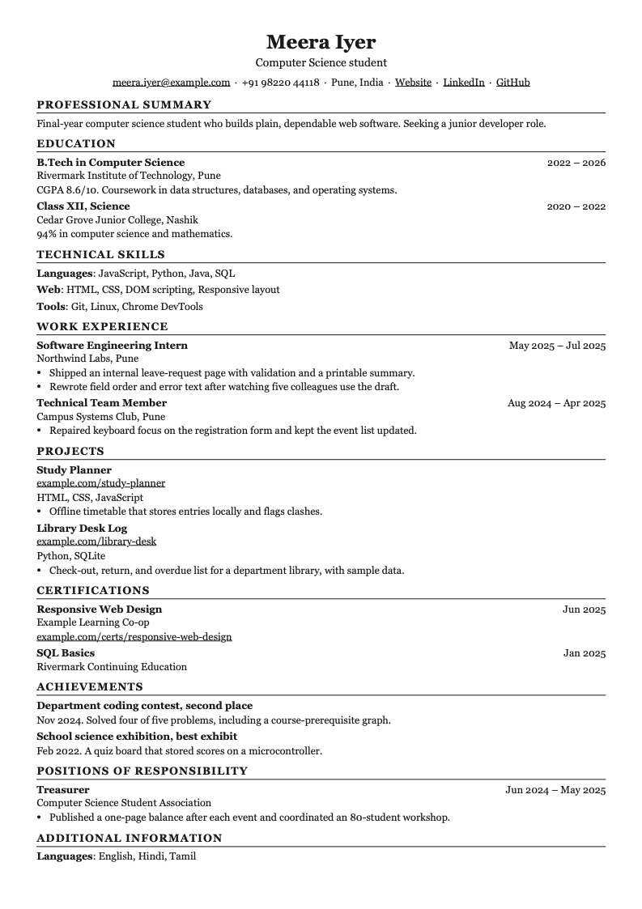
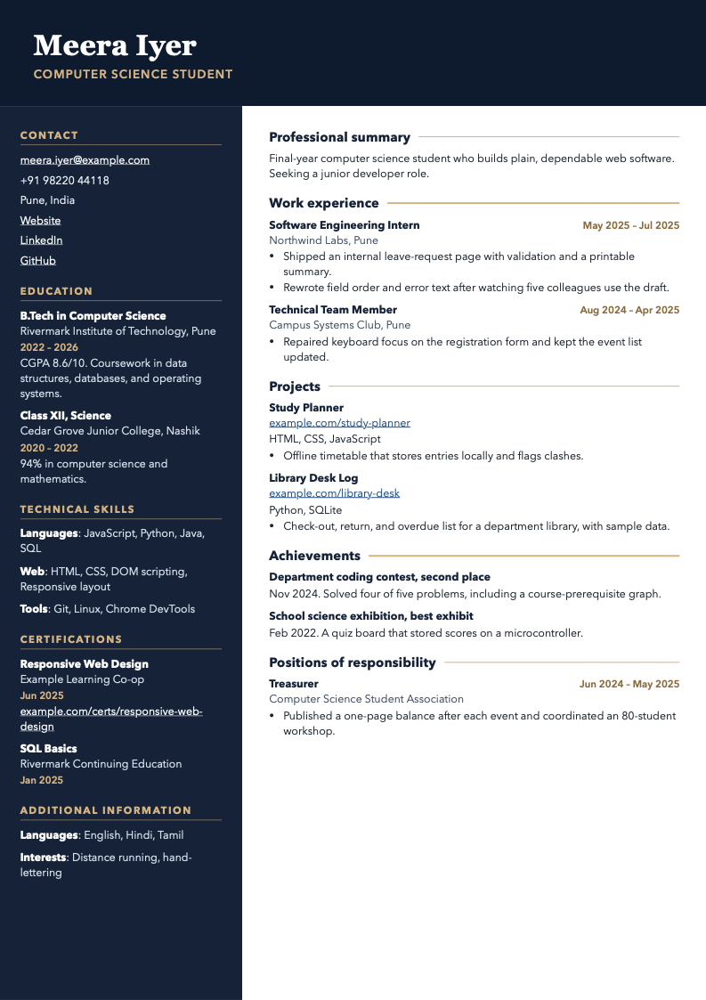

# Offline Resume Builder

A browser application for writing, previewing, and exporting a resume on your own computer. It does not use an account, a backend, or an external API.

**BSERC GenAI Internship — Week 2, Project 3**

## Overview

Hosted resume builders ask for an account and upload the document. This one stays on the device. Open `index.html`, edit the ten resume sections, choose Classic, Modern, or Creative, and print an A4 PDF from the browser. The resume is real HTML text, so it can be selected in the PDF.

The sample resume is fictional. It is there so the preview is useful before the first edit. After an edit, the browser saves the document locally and restores it on the next visit.

## Screenshots

These files are in the repository and were captured from this build.



The home view shows the sample resume summary: Classic, 10 of 10 sections, and 2 A4 pages.



The editor and the Classic preview sit side by side. Personal information stays pinned at the top.



Classic, Modern, and Creative change the layout only. The resume data stays the same.



At 390px the editor stacks into one column. The fields remain readable.



This image is a raster of a PDF file saved by headless Chrome, not a screenshot of the on-screen preview.



The Creative PDF keeps the dark sidebar when background graphics are printed.

## Features

- Ten sections: personal information, professional summary, education, technical skills, work experience, projects, certifications, achievements, positions of responsibility, and additional information.
- Add, edit, and delete entries. Empty entries and empty sections stay off the page.
- Optional sections can be removed and added again. Personal information cannot be removed.
- Classic, Modern, and Creative templates. Switching templates does not change the resume text.
- Drag a section by its handle, or use Up and Down. Arrow keys move the focused handle. Personal information stays first.
- The preview is packed into real A4 pages. The on-screen pages and the printed pages are the same DOM.
- Preview pages scale down to fit a narrow pane. The page box stays 210mm by 297mm.
- Export PDF opens the browser print dialog. The resume text is HTML, not a picture.
- Download JSON and load a checked JSON file.
- Autosave in `localStorage`, with a safe fallback when the saved value is corrupt or storage fails.
- Works from the file on disk. No install step and no network request.

## Technology

| Technology | Role |
| --- | --- |
| HTML5 | Page structure in `index.html` |
| CSS3 | Dark glass interface, three resume templates, A4 page, print rules |
| JavaScript | Classic scripts. No bundler, framework, or package manifest |
| DOM | Editor and resume built with `createElement` and `textContent` |
| `localStorage` | Autosave and restore |
| `FileReader` | JSON import |
| `window.print()` | PDF path through the browser print dialog |
| `crypto.randomUUID()` | New section and entry ids, with a fallback when UUID is unavailable |

System fonts only: a sans-serif for the interface, Georgia for Classic, and Avenir Next or the next available sans-serif for Modern and Creative. Nothing is loaded from a CDN.

## Architecture

One resume object is the source of truth. Renderers and the shell subscribe to it. Listeners receive a frozen copy. User text is written with DOM text nodes, and links are created only for `http://`, `https://`, and `mailto:`.

```text
resume-builder/
├── index.html
├── css/
│   ├── editor.css                 Interface, layout, dialogs, print hiding
│   ├── resume.css                 A4 page, shared resume type, print page size
│   └── templates/
│       ├── classic.css
│       ├── modern.css
│       └── creative.css
└── js/
    ├── schema.js                  Section catalog, factories, template ids
    ├── sample.js                  Demonstration resume
    ├── validate.js                Document and import checks
    ├── state.js                   Mutations and subscribers
    ├── storage.js                 localStorage load, save, and autosave
    ├── io.js                      JSON download and file read
    ├── render-editor.js           Editor form
    ├── render-resume.js           Resume DOM for all three templates
    ├── paginate.js                A4 page packing
    ├── dnd.js                     Drag, Up/Down, and keyboard reordering
    ├── preview-scale.js           Fit the preview to the pane
    ├── main.js                    Startup
    └── shell.js                   Navigation, overview, import, and print
```

Scripts load with `defer` in that order.

## Getting started

```bash
git clone https://github.com/Victor5899/offline-resume-builder.git
cd offline-resume-builder
```

Open `index.html` in a current desktop browser. A double-click is enough. No install step and no local server are required.

The sample resume appears when this browser has no saved resume. Use the pill navigation or the hero buttons to move between the editor, templates, preview, and settings.

## Usage

| Action | Result |
| --- | --- |
| Edit a field | The preview updates immediately. A valid change is saved on this device after a short pause. |
| Add entry | Adds a blank entry and focuses its first field. A blank entry is left off the page. |
| Delete entry | An empty entry is removed at once. An entry with text asks for confirmation. |
| Remove section | Asks for confirmation, then removes that section. Add it again from the bottom of the editor. Its previous text is not kept. |
| Up, Down, drag, or arrow keys | Moves that section. Personal information stays first. Focus returns to the control that moved it. |
| Templates | Applies Classic, Modern, or Creative without changing the resume data. |
| Download JSON | Saves `resume.json`, or `resume-` plus the name when the name contains letters or digits. |
| Load JSON | Checks the file, then asks before replacing the resume on screen. Cancel keeps the current resume. |
| Clear saved data | Removes the copy in this browser. The resume on screen stays. A refresh loads the sample until the next edit. |
| Export PDF | Opens a short confirmation, then the browser print dialog. |

### JSON import and export

The file is a document with `version`, `template`, and `sections`. Version 1 is the only supported version. The template must be `classic`, `modern`, or `creative`.

Import rejects malformed JSON, a file over 1 MB, an unknown template, a duplicate id, a missing personal section, an unknown field, and the keys `__proto__`, `constructor`, and `prototype`. A rejected file does not change the resume on screen.

A website, LinkedIn, GitHub, project, or credential link must be blank or start with `http://` or `https://`. Other text in those fields is kept while you edit, and it is saved on this device, but a JSON file that contains it is rejected. The preview does not turn that text into a link.

### PDF export

In the print dialog:

1. Choose A4 paper.
2. Set margins to None.
3. Turn on background graphics so Modern and Creative colors are kept.
4. Choose Save as PDF.

The stylesheet asks for an A4 page with no extra margin. The app cannot set the dialog's paper size for you. Those three choices are what keep the saved file aligned with the preview.

### Offline behavior and privacy

Stylesheets and scripts use relative paths. The JavaScript does not call `fetch` or `XMLHttpRequest`. Opening the file does not contact a resume service.

The sample contains `https://example.com/...` links and a `mailto:` address. Those are document content. The application does not request them.

Saved resumes stay in this browser's `localStorage` under the key `resume-builder:v1`. Download JSON if you want a copy you can move to another computer.

## Testing

There is no automated test suite in the repository. The results below are from a temporary Node harness and headless Chrome during the Phase 7 audit on 8 November 2026. The harness is not part of the application. Counts are from that run, not from an earlier phase.

### Logic checks

Node loaded `schema.js`, `sample.js`, `validate.js`, `state.js`, `storage.js`, `io.js`, and `dnd.js` and ran 41 checks. All 41 passed.

They covered the sample document, edits in every repeatable section, empty entries, section removal and restoration, template changes that keep section data, rejected unknown templates, personal information staying first, unique ids, JSON round-trip, malformed JSON, duplicate ids, hostile keys, `javascript:` and `data:` URLs, the 1 MB limit, corrupt storage, quota and storage failures, autosave, cancelled autosave, and the absence of `fetch` and `innerHTML` in the scripts.

`Object.prototype` was not polluted by the hostile JSON samples.

### Browser checks

Headless Chrome opened `file:///.../index.html`. A fresh profile was used. 53 browser checks were run in that session. 52 passed. One failed inside the harness, and a follow-up check explained it.

Passed checks included:

- The sample boots with Meera Iyer, Classic, 10 of 10 sections, and no console errors.
- Chrome recorded no request to a remote host.
- Classic and Modern sample previews are 2 pages. Creative is 1 page. Page boxes measured 794 by 1123 CSS pixels, which is 210mm by 297mm at 96 CSS pixels per inch.
- Expected sample text was present. No inspected text box crossed its page edge. No page ended with a heading and nothing under it.
- Keyboard ArrowUp, the Down button, and a pointer drag on the handle reordered sections and restored focus. Personal information stayed first and its controls stayed disabled.
- Adding an entry left it off the preview until it had text. A long URL and a long bullet stayed inside the page. An `` payload was rendered as text.
- Invalid JSON left the current name in place. A valid export loaded back.
- Autosave survived a reload. Corrupt storage loaded the sample and explained why. A thrown `localStorage.setItem` left the editor usable and showed "Save failed". Clear saved data removed the stored copy and kept the on-screen resume.
- At 1440, 1280, 768, 390, and 320 CSS pixels, `documentElement.scrollWidth` did not exceed the viewport. The print dialog fit the viewport.
- Editing while the Settings view hid the preview produced 2 pages, not hundreds, and those pages did not clip when Preview was opened.

The failed harness check expected a visible outline immediately after `element.focus()`. In that headless session the element was active, but `:focus` styles were not applied. With Chrome's focus emulation enabled, the same heading computed as `rgb(255, 105, 95) solid 2px`.

### Saved PDF checks

These are files written by Chrome's `Page.printToPDF`, with A4 page size, zero margins, and background graphics. They are not emulated print-media screenshots. PDFKit read the text layer and the media box. Page rasters were taken from those files.

| File | Pages | Media box | What the text layer contained |
| --- | --- | --- | --- |
| Sample, Classic | 2 | 594.96 × 841.92 pt | Both pages had text. Page 2 was the continued Additional information line, "Interests: Distance running, hand-lettering", under its heading. |
| Sample, Modern | 2 | 594.96 × 841.92 pt | Page 2 contained Positions of responsibility and Additional information. |
| Sample, Creative | 1 | 594.96 × 841.92 pt | The sample text, including the headline, education, and projects. |
| Short Classic resume | 1 | 594.96 × 841.92 pt | Name, contact, and "One page summary." No second page. |
| Longer Creative resume | 2 | 594.96 × 841.92 pt | Page 2 repeated the name banner and continued Work experience. The DOM clip check for that layout reported 0 overflowing boxes. |

594.96 × 841.92 pt is the A4 media box Chrome writes for `@page { size: A4 }`. ISO A4 is 595.28 × 841.89 pt. The difference is under 0.4 pt.

PDFKit returned strings from every page, so the files contain a text layer rather than a single page image. A mouse selection inside Preview was not performed. Modern and Creative headings use letter-spacing, and PDFKit's string for those headings inserts spaces between letters. The painted headings in the rasters read as normal words.

## Known limitations

- The print dialog's paper size, margins, and background graphics are the browser's settings. The page can only tell you what to choose.
- At 320px the primary navigation scrolls inside its pill. Preview and Settings are reached by scrolling that pill. The page itself does not grow sideways.
- A section that barely overflows can leave a short final page. The Classic sample does this: page 2 holds one continued line and its heading.
- Creative continuation pages repeat the name banner.
- A link that is not `http://`, `https://`, or blank can remain in the on-screen resume and in `localStorage`, but it cannot be imported from JSON until it is corrected. The preview shows it as text.
- Clearing saved data does not reset the resume you are looking at.
- Letter-spaced headings can extract from a PDF with spaces between the letters.
- This audit did not include a physical trackpad drag or a click-drag selection inside the macOS Preview app.

## Roadmap

- [x] Phase 1 — Application shell and Classic preview
- [x] Phase 2 — Resume editor
- [x] Phase 3 — Modern and Creative templates
- [x] Phase 4 — A4 pagination and PDF layout
- [x] Phase 5 — Section reordering and preview scaling
- [x] Phase 6 — JSON import and export, and local persistence
- [x] Phase 7 — Audit fixes recorded in this file

Phase 7 is waiting for review before the build is called release-ready.

## Acknowledgements

This project is coursework for the Bharat Space Education Research Centre (BSERC) GenAI Internship, Week 2, Project 3.

## License

Licensing has not been specified. This repository does not include a license file.
